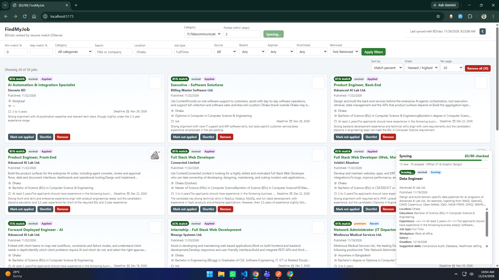
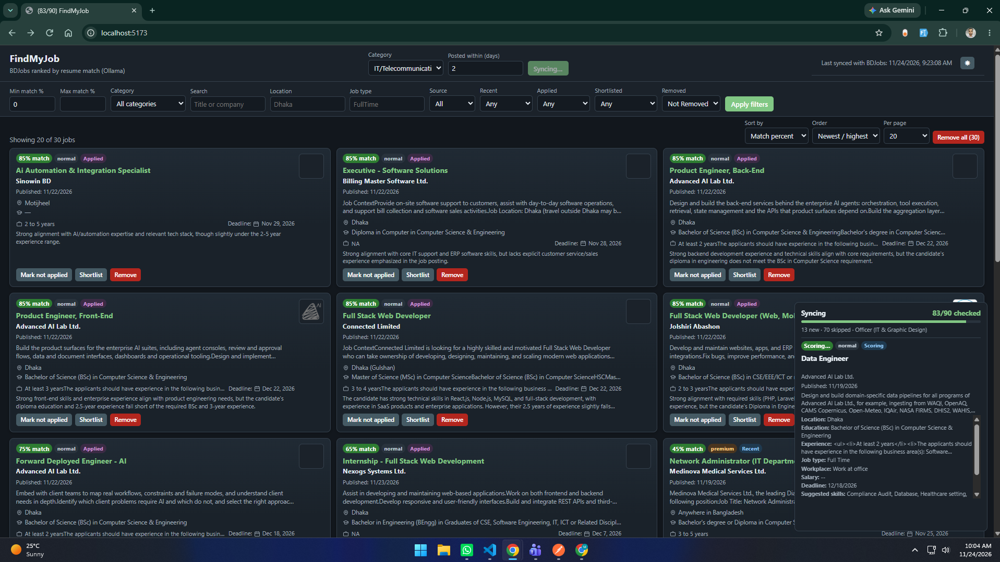

# FindMyJob

FindMyJob is a personal job-discovery and matching app for BDJobs. It syncs job listings from BDJobs, fetches available job details, and uses a local Ollama model to compare each new listing with your resume. Jobs are saved in MongoDB so you can review, filter, shortlist, and track them from a web interface.

## Previews

### Light theme



### Dark theme



## Features

- **BDJobs sync:** Sync listings by category and posted-within days. The category and day range are selected in the interface.
- **Resume-based matching:** Scores new jobs against your resume using an Ollama model. Match scores and a short explanation are saved with each job.
- **Detailed job data:** Fetches available job details, including skills and requirements, to enrich matching and job previews. Listing data is still used if details cannot be fetched.
- **Live sync progress:** Shows the current job and sync counts in the app, and the browser tab title displays progress while syncing.
- **Job discovery controls:** Search and filter by match score, posting age (rolling days), category, location, job type, source, recent status, applied status, shortlist status, and removed status.
- **Sorting and infinite scroll:** Sort by match percentage, sync time, publish date, or first-seen date; additional results load as you scroll.
- **Job tracking:** Mark jobs as applied, shortlist or unshortlist them, remove individual jobs, or bulk-remove all jobs matching the active filters.
- **Theme toggle:** Switch between light and dark themes; your selection is saved in the browser.
- **Last-sync status:** Shows when the job list was last synced with BDJobs.

## Requirements

- Node.js 18 or newer and npm
- MongoDB connection string (for example, a MongoDB Atlas cluster)
- [Ollama](https://ollama.com/) running locally or at a reachable URL, with a model pulled
- A resume saved as `RESUME.md` in the project root

## Setup

1. Install the API dependencies from the project root:

   ```powershell
   npm install
   ```

2. Install the frontend dependencies:

   ```powershell
   npm install --prefix frontend
   ```

3. Create your backend environment file:

   ```powershell
   Copy-Item .env.example .env
   ```

   Edit `.env` and set your MongoDB connection string and any other required values. Do not commit credentials.

4. Create `RESUME.md` in the project root and add the resume text you want the matcher to use. Keep personal information private and do not commit your resume.

5. Install and start Ollama, then pull a model. For example:

   ```powershell
   ollama pull qwen3:14b
   ```

   Set `OLLAMA_MODEL` in `.env` to the exact model name shown by `ollama list`.

6. Optionally configure the frontend API origin by creating `frontend/.env`:

   ```dotenv
   VITE_API_BASE_URL=
   ```

   Leave it blank for the included Vite development proxy (`localhost:5173` to `localhost:3000`). Set it to the API's base URL when the API is hosted elsewhere.

## Configuration

| Variable | Required | Default | Description |
| --- | --- | --- | --- |
| `BDJOBS_GET_JOBS_URL` | Yes | — | BDJobs job-search API URL. |
| `BDJOBS_GET_JOB_DETAILS_URL` | Yes | — | BDJobs job-details API URL/prefix used with a job ID. |
| `MONGODB_URL` | Yes | — | MongoDB connection string. |
| `OLLAMA_BASE_URL` | No | `http://127.0.0.1:11434` | Ollama server URL. |
| `OLLAMA_MODEL` | No | `llama3.2` | Model name to use for matching. Ensure the model is installed in Ollama. |
| `PORT` | No | `3000` | API server port. |
| `RPP` | No | `50` | Number of BDJobs results requested per page. |
| `MAX_PAGES` | No | `50` | Maximum number of BDJobs pages to process per sync. |
| `FRONTEND_ORIGINS` | No | `http://localhost:5173` | Comma-separated list of allowed frontend origins. |
| `AUTO_SYNC_HOUR` | No | Disabled | Run a cron sync every N hours, at the corresponding local clock-hour boundaries. Set to `2` to run at 00:00, 02:00, 04:00, and so on. |
| `AUTO_SYNC_CATEGORY_ID` | No | No category filter | BDJobs category used by scheduled syncs. |
| `AUTO_SYNC_POSTED_WITHIN_DAY` | No | `1` | Posted-within day range used by scheduled syncs. |
| `VITE_API_BASE_URL` | No | Empty | Frontend API origin; leave empty to use same-origin/Vite proxy behavior. |

The backend reads `.env` from the project root. `.env` is ignored by Git; use `.env.example` as a starting point.
Automatic sync does not run immediately on startup. It runs on the configured cron schedule using the category and day range from `.env`; a scheduled run is skipped if a manual or other sync is already in progress.

## Run locally

Start the API in one terminal:

```powershell
npm run dev
```

Start the frontend in another terminal:

```powershell
npm run dev --prefix frontend
```

Open [http://localhost:5173](http://localhost:5173). The API runs at `http://localhost:3000` by default. MongoDB and Ollama must be reachable before syncing jobs.

## Build

Build/type-check the API:

```powershell
npm run build
```

Build the frontend:

```powershell
npm run build:web
```

## API overview

- `GET /api/health` — API health check.
- `GET /api/sync/status` — last successful sync time.
- `POST /api/sync` — start a sync. JSON body accepts `categoryId` and `postedWithin` (a positive number of days; defaults to `1` on the backend). Returns `202` when started and `409` if a sync is already running.
- `GET /api/jobs` — list and paginate jobs. Supports filters such as `min_match`, `max_match`, `posted_within` (positive number of rolling days), `cat_id`, `q`, `location`, `job_type`, `source`, `is_recent`, `is_applied`, `is_sort_listed`, and `is_removed`, plus `page`, `page_size`, `sort`, and `sort_direction`.
- `GET /api/jobs/:id` — retrieve a job by its BDJobs ID.
- `PATCH /api/jobs/:id` — update `isApplied`, `isRemoved`, and/or `isSortListed`.
- `POST /api/jobs/bulk-remove` — mark all jobs matching the provided `filters` as removed.
- `ws://localhost:3000/ws` — live sync progress events for the frontend.

## How matching works

For each new listing, the backend attempts to fetch its details and compares the available job information with `RESUME.md` using the configured Ollama model. It stores a 0–100 match score, a short reason, the original listing, and available details. Existing job IDs are not scored again during sync.
